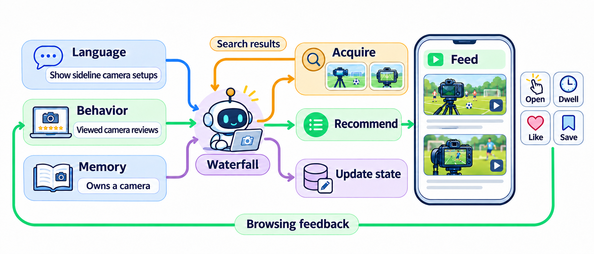
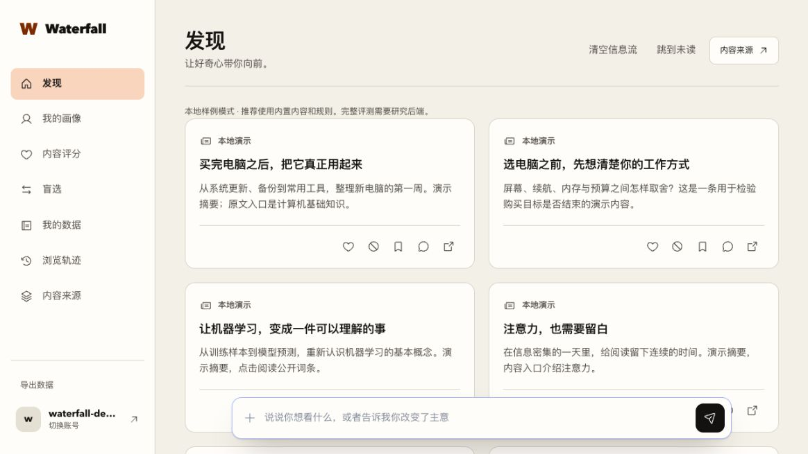
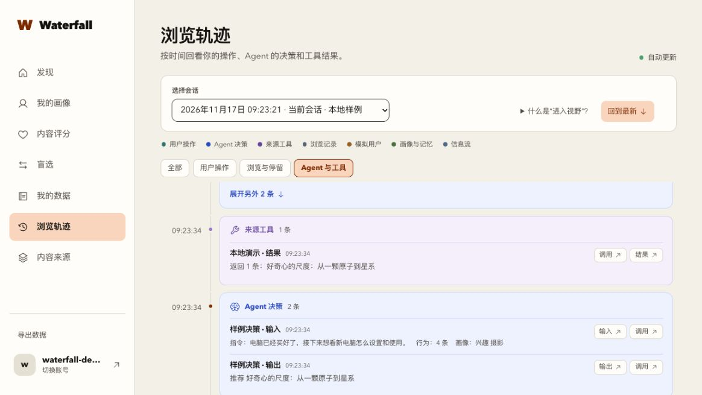
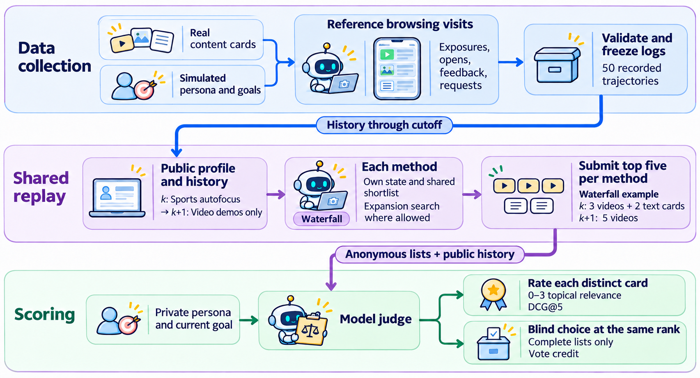

# 🌊 Agentic Waterfall

Tell the feed, "I already bought the camera. Show me how to film from the sidelines." Waterfall uses the request, recent browsing, and what it knows about you to decide what to search for, what to move up in the feed, and what to remember.

[Waterfall Dataset](https://github.com/XiaoLuoLYG/agentic-waterfall-dataset) · [🏆 Leaderboard](https://xiaoluolyg.github.io/agentic-waterfall-dataset/) · [Reproduce results](docs/reproduce.md)



## 🖥️ Try the demo

Use Node.js 22.13 or newer.

```sh
git clone https://github.com/XiaoLuoLYG/waterfall-anything.git
cd waterfall-anything
node demos/agentic-feed-site/scripts/local-demo.mjs
```

Open `http://127.0.0.1:4196`. Make a local account, choose an interest, and browse the feed. Give the feed a new instruction and open the trace to see the next decision. The sample catalog runs without API keys. It uses scripted decisions so you can try the feed and the same action runtime locally.

In sample mode, try: "电脑已经买好了，接下来想看新电脑怎么设置和使用。" The trace shows the purchase goal being marked complete.

To use your own model and content providers, see the [demo setup](demos/agentic-feed-site/README.md).

The local demo, using the sample catalog:



<details>
<summary>See the decision trace</summary>



</details>

## Run the core

```sh
node examples/run-core.mjs
```

The example searches two sample cards and recommends the one about filming. It prints the IDs and action receipts so you can see what the runtime did. The browser demo and benchmark runners load the same [Waterfall core](demos/agentic-feed-site/lib/waterfall/waterfall-core.mjs).

## 📊 Reproduce the paper results

Score replay recalculates the published scores from saved rankings and judgments, without calling a model. The [reproduction guide](docs/reproduce.md) has the downloads and commands, plus instructions for running the benchmark adapters on new predictions.



## Repository layout

```text
examples/run-core.mjs          Small runnable core example
demos/agentic-feed-site/
  lib/waterfall/               Shared core, model and data adapters
  public/                     Browser interface
  scripts/                    Local demo and research service
  drizzle/, db/               Hosted database schema and migrations
demos/agentic-feed/            Compatibility imports used by research
experiments/agentic-waterfall/ Input preparation, runners, scorers
methods/agentic-waterfall/     Baseline methods and their adapters
output/agentic-waterfall/      Frozen source dependencies for paper runs
docs/                         Setup, results, figures, and research notes
```

The active core is `demos/agentic-feed-site/lib/waterfall/waterfall-core.mjs`. The demo and current research adapters import it. The source files under `output/` preserve the adapters used by the archived experiments; those files are needed to reproduce the recorded runs. Data downloads and the leaderboard live in the [dataset repository](https://github.com/XiaoLuoLYG/agentic-waterfall-dataset).
