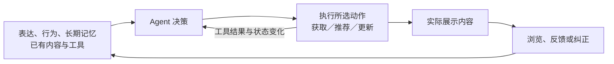

# Agentic Waterfall Feed：研究主方案

2026-10-29 · 当前研究主入口，按论文顺序整理。配套：[输入输出与数据流](02-输入输出与数据流.md)；实施参数与来源放在 [评测细则](materials/references/evaluation-details.md)、[文献核查](materials/references/prior-work-check.md)。九项实验按两表列于第5节。

**当前执行状态（2026-10-30）：四组公开实验按后续授权运行，MIND与盲选仍暂停。** 统一进度、方法组合、数据分母和运行边界见[当前实验总览](../../../methods/agentic-waterfall/当前实验总览-20261030.md)。第5节的进度为10月29日停止时的历史快照。 研究设计保留跨系统盲选、逐系统内容评分和五组消融（含去用户表达、去行为记录）；AgentRecBench已纳入，记忆长期保留，暂不研究跨会话、清空记忆或遗忘。已有公开数据小样本运行不等于正式效果结论。

## 1. 研究主线与核心贡献

**定义 Agentic Waterfall Feed：Agent 根据用户表达、浏览行为和长期记忆，持续决定找什么、推荐什么、更新什么，让用户获得更好的连续浏览体验。** 目标是 ACL 主会。

自由刷信息流是主场景。用户可以不说话，也可以随时改变方向，例如“电脑已经买好了，接下来想学剪辑”。好的系统应持续提供合意的内容，并跟上这些变化；点击与停留是输入信号和辅助记录，不能单独代表推荐质量。

| 核心贡献 | 论文交付什么 | 需要的证据 |
|---|---|---|
| **问题与范式** | 三类用户输入、结构化动作与连续交互过程，让不同系统研究同一个问题 | 明确任务、可复用接口和覆盖关键情境的基准 |
| **Agent 框架** | 根据已有内容、反馈和状态，按需选择获取、推荐与更新 | 完整系统对比，以及行动选择、获取、状态更新的消融 |
| **数据与评测** | 完整轨迹、真人逐条评分、跨系统盲选、经过真人检验的模拟数据 | 单系统得分、系统间比较、模拟一致性与扩量收益 |

**数据与评测预计承担论文约一半贡献。** 方法创新重点是如何选择和组合行动；JSON、工具接入和网页本身是实现基础。论文中的效果主张由实验检验。

## 2. 相关工作与创新点

| 近邻 | 已有能力 | Waterfall 重点比较什么 |
|---|---|---|
| [RecBot](https://arxiv.org/html/2509.21317v2) | 命令控制信息流、偏好维护、工具链、多轮交互 | 从命令驱动的推荐调整扩展到获取、推荐与状态更新的整体决策 |
| [ClawRec](https://arxiv.org/html/2607.23779v1) | 跨平台行为、用户状态、来源规划、获取、筛选与反馈 | 最接近的完整系统对照；比较自由浏览、主动纠正和连续反馈下的内容收益 |
| [MARS](https://arxiv.org/html/2605.14401v2) | 分层记忆、记忆生命周期调度、基于记忆的排序 | 记忆与用户理解如何进一步影响获取和后续推荐 |

创新主张落在三者共同支撑的研究贡献上：**完整的连续信息流任务、按需行动的参考框架、真人支持的端到端数据与评测。** 通过强对照识别实际差异，不把已有的单项能力重新包装为首次提出。

## 3. 问题定义、方法与架构

| Agent 输入 | 具体内容 |
|---|---|
| 用户表达 | 指令、评论、纠正及相关对话；允许为空 |
| 行为记录 | 实际曝光、打开、停留、赞踩、收藏及对应内容与时间 |
| 用户状态 | 事实、偏好、当前需求、要求与历史经历 |
| 运行环境 | 已取得内容、待展示队列、可用来源、工具返回和预算 |

Agent 输出一个或多个动作：**获取 `acquire`、推荐 `recommend`、更新 `update_state`**；必要时回复、询问、等待或结束当前任务。已有内容足够时可以只重排；需要补充时再搜索；没有新指令也能依据行为运行。

架构分为信息组织、Agent 决策、工具执行和交互记录。执行器解析动作及依赖：独立搜索可并行；取得新内容后，结果返回 Agent，再决定推荐什么。推荐入队、实际曝光和用户反馈分别记录。

**记忆统一长期保留。** 当前需求可以完成，偏好可以被新证据修正，但记录不因会话结束或时间经过而自动清空、遗忘；“适用于当前任务”和“保存多久”是两回事。本阶段只检验连续交互中的更新作用，不设跨会话实验。完整字段与逐步例子见[输入输出说明](02-输入输出与数据流.md)。

## 4. 自采数据与两种并列评测

一条完整数据是：**用户起点 → 每轮输入 → 系统动作与工具返回 → 推荐与实际曝光 → 本人判断和反馈 → 下一轮。** 同时保存可搜索的内容快照、统一内容 ID、状态变化、模型版本、成本和结束原因。新查询应能访问共同内容环境，不能只回放 Waterfall 已搜过的结果。

### 跨系统比较与逐系统打分并列

| | 跨系统盲选 | 逐系统内容评分 |
|---|---|---|
| 用户做什么 | 在不同系统的实际推荐中选更想看的；允许都想、都不想 | 对某个系统推荐的每条内容逐条评分 |
| 回答什么 | 同样的上下文下，更喜欢谁的推荐？ | 这个系统推荐得怎么样？ |
| 得到什么 | 四类选择占比、系统间偏好差异 | 单轮 DCG、连续累计回报及逐轮曲线 |
| 是否需要其他系统 | 需要 | 不需要，单个系统也能评 |
| 身份处理 | 隐藏系统身份，随机左右位置 | 同样隐藏系统身份，统一内容展示 |

**“盲”是隐藏身份；真正并列的是跨系统比较和逐系统打分。** 两类结果分别报告，不合成总分。两条评测均为正式设计，不把盲选降为内容评分的附属环节。

### 一位参与者怎样完成内容评测

**正常浏览 → 开启内容评测 → 推荐 5 条并逐条评分 → 已发生反馈进入下一轮 → 共 3 轮。**

先用 **3 轮×5 条** 试采；标签暂定为 **0 不感兴趣／1 一般／2 喜欢／3 很喜欢**，无法判断另记。轮次和评分尺度在试采后固定。不做系统满意度或易用性问卷，不要求用户必须有明确任务。

每轮先固定推荐及顺序，再收评价；上一轮评分和原话可进入下一轮。每个系统持续保有自己的记忆，只收到自己实际展示内容产生的反馈。跨系统盲选和混合标注放在独立比较区或连续使用结束后，答案不广播给各系统冒充共同未来。

| 内容评分指标 | 计算与含义 |
|---|---|
| **DCG@5** | `Σ r_k / log₂(k+1)`，直接使用 0–3 标签；衡量这一批内容及顺序 |
| **累计回报** | 固定推荐机会下各轮实际内容评分之和；衡量整段提供的内容价值 |
| 逐轮曲线 | 每轮均分和 DCG；观察反馈、纠正后的变化，不另起综合指标 |

DCG 沿用[标准定义](https://scikit-learn.org/stable/modules/generated/sklearn.metrics.dcg_score.html)；连续奖励之和参考 [KuaiSim §4.2](https://arxiv.org/html/2309.12645v1#S4.SS2)，本基准将即时奖励具体设为真人内容标签。累计回报高不单独证明适应得更好，需要结合曲线与消融。

同一截止点也可合并各系统输出、匿名逐项评分，再按原排名还原每个系统的 DCG。**NDCG 使用共同完整标注池的理想排序**，不让各系统只用自己的五条作评价全集。推荐失败、未答和无法判断分开保存；详细缺失处理及演算见[评测细则](materials/references/evaluation-details.md)。

## 5. 用哪些实验回答这些问题

以下两表合计九项实验，进度为2026-10-29停止时的快照，后续实际状态以[实验记录](../../../experiments/agentic-waterfall/STATUS.md)为准。**当前只整理文档，不启动运行；盲选保持暂停。** “原定”沿用主线，“可补”是尚未批准的新增比较；训练“后置”也是待确认的优先级建议，不等于删除原对照。

### 5.1 公开基准与模拟验证

| 数据／实验 | 测什么、怎么测 | 比较方法 | 训练要求 | 目前进度 | 缺口 → 确认后的下一步 |
|---|---|---|---|---|---|
| **ClawRec-SimBench** | 由已有行为找下一步内容；Hit@20、共享池NDCG@20 | 原定：Waterfall、ClawRec、通用Agent。可补：i2Agent＋公共检索、固定检索 | 免新增训练，使用现有模型 | 数据齐；ClawRec只完成状态与规划 | 缺共同搜索环境、完整推荐链 → 先完成三方法同条件比较 |
| **KuaiRec** | 全目录寻找并推荐视频；Recall@10、NDCG@10 | 原定：Waterfall、ClawRec、LightGCN、固定检索。可补：i2Agent、通用Agent；RecBot/MARS仅候选重排 | LightGCN需匹配权重或训练，建议后置 | 数据齐；短训和小样本诊断完成；ClawRec未接 | 缺完整检索、方法适配和同用户比较 → 先做Agent侧，训练资源另定 |
| **AgentRecBench** | Amazon／Yelp／Goodreads中，20候选找正例；HR@1/3/5 | 当前：Waterfall、官方RecAgent；Baseline666因无可核实作者代码按用户决定移出。可补：ClawRec、i2Agent、MARS、RecBot、通用Agent、固定排序 | 官方RecAgent免新增训练；RecBot及Baseline666另核 | 仅Amazon短历史3题诊断；候选漏传已离线修复 | 缺同预算正式比较、其他领域数据 → 先确定Amazon同样本比较 |
| **MIND-small** | 同历史、同新闻候选，看点击新闻是否排前；AUC/MRR/NDCG | 原定：Waterfall、NRMS、TF-IDF。可补：ClawRec候选版、i2Agent、通用Agent、MARS、RecBot | NRMS需匹配权重或训练，建议后置 | Waterfall1000题处理完、305失败；TF-IDF1000题完成；NRMS已中止，未统一评分 | 缺评分与Agent横向对照 → 可先汇总已有两者；新增方法先统一预算、另行确认 |
| **KuaiRand-1K** | 根据观看历史预测下一条长观看视频；Hit/NDCG | 原定：Waterfall、SASRec、LLM-SRec。可补：ClawRec候选版、i2Agent、MARS、RecBot、通用Agent、固定排序 | SASRec、LLM-SRec需权重或训练；LLM-SRec建议暂缓 | 时间问题已修正；仅2题诊断，SASRec短训，LLM-SRec未跑 | 缺训练资源与充分文本 → 先核权重及资源，不默认本机长训 |
| **模拟用户一致性** | 比AI与本人评分/选择；之后检验模拟数据是否帮助推荐 | 真人 vs 模拟判断；数据增益比真人、真人＋模拟、真人＋校准模拟三种训练数据 | 一致性不需训练；数据增益需训练小排序器，建议后置 | 只有合成检查；0真人、未拟合 | 缺真人参照 → 先有真人数据，再验证一致性，最后考虑增益训练 |

### 5.2 跨系统内容评分、盲选与消融

“跨系统内容评分”指分别取得各系统的逐条评分，再比较系统间差异，沿用第4节的0–3标签、DCG和累计回报；与成对盲选分别报告，不新增第十项实验。

| 数据／实验 | 测什么、怎么测 | 比较方法 | 训练要求 | 目前进度 | 缺口 → 确认后的下一步 |
|---|---|---|---|---|---|
| **跨系统内容评分** | 3轮×5条，本人打0–3分；看单轮DCG和累计得分 | 先Waterfall、ClawRec；后续i2Agent＋公共检索、通用Agent、固定检索。RecBot/MARS另做固定候选专项 | 主表免新增训练；RecBot组件另核 | 有离线评分工具；0真人，完整评分入口未接 | 缺共同内容、入口与本人标签 → 先明确试采步骤和改动范围 |
| **盲选（暂停）** | 隐去系统名字，本人选择更想看的推荐 | Waterfall、ClawRec、i2Agent＋公共检索、通用Agent、固定检索 | 免新增训练 | 有工具及离线导入器；0真人，demo未改 | 缺真实系统输出和本人选择 → **保持暂停，不改、不采、不跑** |
| **五组消融** | 每次改一个设计，看推荐得分是否下降 | 完整Waterfall vs 去表达、去行为、固定流程、禁获取、冻结状态 | 免新增训练 | 开关和合成检查完成；无有效效果比较 | 缺完整基线和真实反馈 → 完整系统跑通后，再同条件比较六版 |

### 5.3 训练与公平比较边界

- **优先使用现有模型。** Waterfall、ClawRec、i2Agent、通用Agent、官方RecAgent及MARS不以新增大模型训练为前提；TF-IDF/BM25或现成BGE仍有建索引、编码和推理成本。实现必须保留对应方法机制，不能用一个提示词冒充完整方法。
- **训练型对照先核权重。** 公平比较要求数据、可见信息和评测条件一致，不要求所有方法都训练。NRMS、SASRec、LightGCN需要已训练参数；可复用权重须匹配数据、ID/词表及切分，且未使用测试答案。没有匹配权重时，先说明硬件、耗时和预算，由用户决定，不默认本机长训。LLM-SRec依赖序列模型与后续训练，建议后置。
- **RecBot单独核实。** 非蒸馏/API版本可省大模型微调，但完整方法仍依赖训练过的AIA推荐组件；实现与权重未齐时明确标未复现。Baseline666源码未核得，按用户决定不纳入当前实验。RecBot、MARS在自采数据上保留固定候选专项，不能混同完整获取对比。
- **MIND等可以补Agent对照。** ClawRec接MIND/KuaiRand是受限候选适配，不能证明完整搜索或语言纠正收益；原数据没有指令就留空，不编造。新增多阶段方法须先统一可见信息、完整流程和预算，现有MIND单次调用结果不能直接拼成新的公平对比表。
- **效果与运行正确性分开。** 完整有效输出率不等于推荐准确率；同样本上比较效果，并单列失败、缺失、成本和不确定性。模拟一致性本身不要求训练，模拟数据增益阶段才训练排序模型；没有真人标签不宣布通过。

各方法从相同原始信息独立建立状态，不把Waterfall已总结的画像交给对手。现有基准沿用各自协议，不做全方法×全数据的无差别组合；新增方法、规模、资源和采集均须明确确认后执行。

**AgentRecBench**使用原任务1个历史正例＋19个未交互候选，接用户、物品和评论查询工具，按领域及情境报告HR@1/3/5；历史窗口变化与真人连续反馈分表。[正式论文](https://papers.neurips.cc/paper_files/paper/2025/file/e2d6f7249add096e26679eade1b4cc6f-Paper-Datasets_and_Benchmarks_Track.pdf) · [官方数据](https://huggingface.co/datasets/SGJQovo/AgentRecBench) · [代码](https://github.com/tsinghua-fib-lab/AgentSocietyChallenge/tree/final)

**ClawRec-SimBench**按隐藏下一步需求评价任务相关性，允许不同URL支持同一需求；模型评分与自采真人判断分表报告。[数据说明](https://github.com/RUCAIBox/ClawRec/blob/main/clawrec-simbench/README.md) · [评分规则](https://arxiv.org/html/2607.23779v1#S4.SS1.SSS2)

## 6. 消融实验：首批五组

**完整系统对比检验整体表现，消融检验哪些设计起作用。** 首批每次只改一项，均与完整 Waterfall 比较：

| 消融版本 | 只改什么 | 回答什么 |
|---|---|---|
| **去用户表达** | 隐去指令、评论、纠正及相关对话，并排除这些输入衍生的记忆与查询 | 显式表达提供多少额外信息？ |
| **去行为记录** | 隐去曝光、打开、停留、赞踩、收藏等事件，并排除这些输入衍生的记忆与查询 | 行为证据提供多少额外信息？ |
| **固定行动流程** | 保留同样模块，每轮固定“更新→获取→排序” | 按需决定何时搜、何时重排是否有效？ |
| **关闭新内容获取** | 仅从起点已有的充足候选推荐，不能继续获取 | 主动获取新内容带来多少收益？ |
| **冻结状态更新** | 保留初始记忆，也接收新反馈，但不写入持久状态 | 持续更新用户理解是否改善后续推荐？ |

固定模型、输入可见规则、内容环境、推荐机会与资源上限；状态冻结版仍看到当前反馈。关闭获取时，两版本共享足以完成实验的初始候选，避免把内容耗尽当作获取收益。

**消融规定比较哪些版本；盲选与内容评分规定怎样评价。** 首批全部版本做逐系统评分，关键对照再做跨版本盲选；这是消融的工作量安排，不改变两条评测的并列地位。真正多轮实验分别采集各版本产生的反馈。

输入消融从同一原始历史按允许来源独立构造状态，避免被删除的输入通过既有记忆泄漏；独立提供的画像保留，来源不明的推断字段不沿用。去画像可留作第二批。用户评分供评价器计算指标，不自动作为被移除的反馈通道再喂给系统。**跨会话、清空长期记忆和遗忘机制实验暂不开展。** 对“电脑已买好”等明确事实可另检查状态是否更新正确，作为辅助诊断，不替代推荐效果。

## 7. 模拟用户与生成数据

| 验证层次 | 怎么做 |
|---|---|
| **个人判断一致性** | 同一人、同一事前历史与内容，预测真人 0–3 评分和盲选；看评分 MAE、选择准确率及错误分布 |
| **系统评价一致性** | 比较真人与模拟评出的各系统 DCG、累计回报、盲选分布及方法差值；检查是否偏袒某个系统 |
| **生成数据是否有用** | 固定同一排序模型，比较真人数据、真人＋未校准模拟数据、真人＋校准模拟数据；统一在留出真人上测试 |

开发用户用于校准，未参与校准的用户用于验证；加入无画像、错配画像和少量真人重复题作参照。单次评分或盲选有效后，再验证连续行为，不能直接推定整段模拟可靠。真人与模拟记录始终分开标记。

## 8. 下一步与当前进度

以下是待确认的研究步骤，不是启动指令；具体方法与资源以第5节两表确认后的方案为准，盲选不随其他项目自动恢复。

1. **先完成一个可核对的三轮样本。** 自由浏览→5 条评分→状态更新→下一批；导出内容、顺序、评分、工具结果和状态变化，能手算复核。
2. **接通内容评分与核心对照。** 优先 Waterfall 与 ClawRec，再按确认的范围接其他方法和五组消融，保持各自状态与反馈独立。匿名盲选仅保留设计，暂停实施。
3. **跑已有基准。** 先核对 ClawRec-SimBench、AgentRecBench 的一条真实样本与评分，再按总表完成各数据的指定对照。
4. **做 8 人试采，再固定正式协议。** 确定评分理解、轮次、耗时、样本量与预算；之后采集正式真人数据、验证模拟用户。

现有 demo 的开发接点、详细预算、评分演算和验收清单统一在[评测细则](materials/references/evaluation-details.md#13-demo-需要补什么)。核心文件仍只有本方案与输入输出说明，历史材料保留在 materials/archive。

当前已完成研究定义、接口、作者样例及部分小样本运行；已有 demo 能力以对应开发记录为准。MIND两套1000题输出已保留，NRMS由用户要求中止，未形成三方法最终比较。全部资源开关已关闭，九个实验聊天已归档；执行记录见 [实验状态](../../../experiments/agentic-waterfall/STATUS.md)。**尚无完整系统胜负或真人结论；不启动训练、模型调用、真人采集或demo修改，待用户确认具体方案后再执行。**
