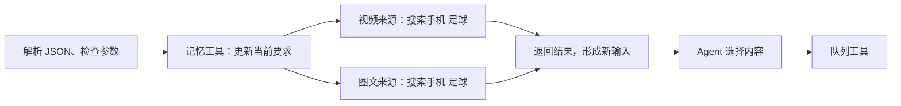

# Agentic Waterfall Feed：输入输出与数据流

2026-10-28 更新。本文合并接口与完整例子，补充两种并列评测与长期记忆约定；问题定义、贡献、评测和 todo 见 [研究主方案](01-研究主方案.md)。

**三类用户信息，加运行环境，输出一组可执行动作。** 下半部分用同一位用户的五阶段浏览说明数据怎样流转。

## 1. 给 Agent 什么

| 字段 | 装什么 |
|---|---|
| `dialogue[]` | 用户和助手的原话、角色、发生/收到时间、指向的内容或任务 |
| `behavior_events[]` | 曝光、打开、停留/播放片段、赞踩、收藏、评论、滚动、进入/离开；含内容与曝光关联 |
| `user_state` | version 与 records；事实、偏好、任务、要求和经历。每条有 scope、status、basis、evidence_refs |
| `environment` | 已取得的内容、当前可见/待展示队列、来源能力、在途动作、实际返回、额度及内容环境版本 |

每次另带 `schema_version, decision_id, user_id, session_id, observed_at, trigger`。冷启动的历史和记忆为空；没有新发言时仍可按行为或工具结果决策。

内容记录包含 ID、来源、类型、标题、实际文本/媒体、时长（适用时）、获取时间和内容 hash。记忆的“明确说过”与“系统推断”分开；偏好/要求用 prefer/avoid、hard/soft，作用范围为当前任务、当前会话或长期。scope 表示信息在什么情境下生效，不表示存储寿命；所有记录长期保留，不因会话结束或时间经过自动遗忘。completed / expired / superseded 等状态只改变当前适用性，原始依据和变更记录继续保存；本阶段不做跨会话或清空记忆实验。

## 2. Agent 输出什么

顶层为 `{decision_id, actions[]}`。每个动作含 `action_id, kind, arguments, evidence_refs, depends_on`。action_id 只是追踪与依赖连接，用户页面显示内容标题。

| kind | arguments | 对应执行工具 |
|---|---|---|
| acquire | source_ids、mode、query、target_id、content_types、constraint_refs、limit | 来源适配器；mode 为 search/hot/browse/subscription 中该来源支持的方式 |
| recommend | ordered_item_ids、delivery=append/replace_pending | 内容队列工具；只选择已经返回的内容 |
| update_state | base_version、edits；upsert 或 set_status | 记忆工具；一次提交后增加版本 |
| respond | kind=answer/explain/clarify、text、target_refs | 对话发送工具 |
| idle | mode=keep/wait/end_task、task_id | 保持/等待/结束指定任务 |

更新记录最小字段：`id, kind, key, value, scope, scope_id, status, basis, evidence_refs`，执行器写 updated_at。kind 为 fact/preference/task/constraint/episode；status 为 active/completed/expired/superseded。完整既有字段参考保留在[早期详细规格](materials/archive/2026-10-27-agentic-feed-io.md)，有冲突时以本目录和当前样例为准。

## 3. 怎样解析、并行与记录

Agent 输出依赖，执行器找出“前置动作已经成功完成”的动作，一起提交。例：

```text
更新当前要求
    ├── 找视频 ──┐
    └── 找图文 ──┤
                 └── 结果回给 Agent → 选择内容 → 更新队列
```

两个 acquire 可并发；依赖状态更新的获取需等待该更新成功。获取未知内容后进行选择，需要下一次模型决策。已有候选的推荐可与独立的新获取并发；本例用两路获取演示并行。对共享状态或同一队列的写入由执行器串行化，不能只因未写依赖就并发覆盖。依赖失败的后续动作不执行；无依赖动作可继续。

执行器将 JSON 当数据解析，再调用固定工具映射；不执行模型生成的程序。先检查字段、来源、候选 ID、状态版本和依赖；保留失败原文及错误。同一 action_id 不重复产生副作用。

### 保存哪些记录

每步保存实际 input、raw_output、parsed_output、校验、调度组、execution_results、state_after。客户端另记实际曝光和反馈窗口；入队不算曝光，没看见不算不喜欢。

起止时间、实际模型/提示词/动作协议、查询环境、采集规则和结束原因归档。对比题的算法身份、用户答案、未来反馈单独保存，不能提前进入被评测 Agent。真人选择是**被记录的评价结果**，不要求模型输出自己的满意度分数。

字段依据：[KuaiRand](https://kuairand.com/)的多信号行为、[MIND](https://github.com/msnews/msnews.github.io/blob/master/assets/doc/introduction.md)的历史/曝光关联、[RecBot](https://arxiv.org/html/2509.21317v2#S3)的要求解析、[ClawRec](https://arxiv.org/html/2607.23779v1#S2)的证据状态与获取追踪。

## 4. 完整例子：用户操作 → 输入 → 输出 → 工具 → 内容

**同一个用户，从随便刷到找到手机拍足球的方法。** 例子使用可读内容名称，不要求记编号。全部数据由作者编写；工具实际运行在本地固定内容环境，未调用真实模型或网络。

下面的输入摘出本轮关键变化，模型同时收到此前记录、当前记忆及内容环境。输出片段使用实际字段和值。每一步未删减的请求、完整 JSON 输出及回执在 [episode.json](materials/example/episode.json)，[逐步 JSON 展开](materials/example/all-step-json.md)用于逐项核对。

### 第 1 步： 新用户进入，先随便刷

用户打开页面，没有发言、画像或历史。给 Agent 的关键输入：

```json
{"dialogue":[],"behavior_events":[{"type":"session_start","payload":{"history_available":false}}],"user_state":{"version":0,"records":[]},"environment":{"candidate_pool":[]}}
```

来源目录同时声明：图文来源支持热榜/搜索，视频来源支持搜索。

| Agent 输出 | 解析后调用 | 实际返回 |
|---|---|---|
| acquire：图文来源、hot、limit=3 | 图文来源的热榜工具 | 《手机摄影：先观察光线》《十分钟做一份早餐》《周末读一本短篇小说》 |
| 返回结果后的第二次输出：recommend，以上述顺序 append | 队列工具 | 三张内容排入待看队列 |

第一个获取动作的真实 arguments：

```json
{"source_ids":["图文来源"],"mode":"hot","query":null,"target_id":null,"content_types":["article"],"constraint_refs":[],"limit":3}
```

网页再记录实际可见：摄影和早餐看见了，阅读内容尚未看见。

### 第 2 步： 用户阅读并收藏，没有说话

用户打开摄影文章，前台阅读 22 秒，点击收藏。新增到输入：

```json
[
  {"type":"open","item_id":"手机摄影：先观察光线","payload":{}},
  {"type":"dwell","item_id":"手机摄影：先观察光线","payload":{"duration_ms":22000,"surface":"detail","foreground":true}},
  {"type":"save","item_id":"手机摄影：先观察光线","payload":{"value":true}}
]
```

| Agent 输出 | 工具怎样执行 | 后续结果 |
|---|---|---|
| update_state：写入“本次打开并收藏手机摄影内容”，scope=session、basis=observed | 记忆工具，版本 0→1 | 保存本次经历 |
| acquire：query="手机 摄影"，图文来源、limit=6，依赖上个更新 | 更新成功后调用搜索 | 得到构图、基础设置、跟拍步骤、检查单、器材参考 |
| 搜索返回后的 recommend | 队列工具重排待看内容 | 推荐构图练习和器材参考；此时还没有“不买器材”的要求 |

这一步没有用户指令。Agent 仍根据实际行为决定获取和推荐。

### 第 3 步： 用户提出需求，两路获取并行

原话：**“周末想用手机拍孩子踢球，不买器材，先给我短教程。”**

输入中加入这句话，同时提供当前记忆和已有候选：

```json
{
  "dialogue":[{"role":"user","text":"周末想用手机拍孩子踢球，不买器材，先给我短教程。"}],
  "user_state":{"version":1,"records":[{"kind":"episode","value":"本次打开并收藏手机摄影内容","scope":"session"}]},
  "environment":{"candidate_pool":[{"id":"手机拍足球：基础设置"},{"id":"手机跟拍足球：四个动作"},{"id":"手机拍运动：开拍检查单"},{"id":"运动摄影镜头怎么选"}]}
}
```

**Agent 输出三个动作。** 先由 update_state 写入当前拍摄任务、“不买器材”的 hard/avoid 要求、“短教程”的 soft/prefer 偏好，版本 1→2。它输出的另外两条搜索动作原文为：

```json
[
  {
    "action_id":"搜索手机足球视频",
    "kind":"acquire",
    "arguments":{"source_ids":["视频来源"],"mode":"search","query":"手机 足球","target_id":null,"content_types":["video"],"constraint_refs":["本任务不买器材","本任务偏好短教程"],"limit":2},
    "evidence_refs":["用户提出手机拍足球的需求"],
    "depends_on":["更新手机足球拍摄需求"]
  },
  {
    "action_id":"同时搜索手机足球图文",
    "kind":"acquire",
    "arguments":{"source_ids":["图文来源"],"mode":"search","query":"手机 足球","target_id":null,"content_types":["article"],"constraint_refs":["本任务不买器材","本任务偏好短教程"],"limit":6},
    "evidence_refs":["用户提出手机拍足球的需求"],
    "depends_on":["更新手机足球拍摄需求"]
  }
]
```

解析器将 kind=acquire 映射到固定来源工具，把 arguments 传进去。两个搜索都等同一次更新完成，彼此没有依赖：



[执行代码](materials/example/replay.py)通过 asyncio.gather 同时调用两路来源，已检查峰值并发数为 2。实际来源查询与返回分别保存。

两路结果回给 Agent 后，它输出 recommend，arguments 为：

```json
{"ordered_item_ids":["手机拍足球：一分钟基础演示","手机拍足球：两分钟跟拍演示"],"delivery":"replace_pending"}
```

队列工具按内容记录生成卡片。网页显示第一条；用户播放 15 秒，写入实际播放片段。图文候选仍保留。

### 第 4 步： 用户改变要求，更新之后重排

原话：**“基础设置我会了，只看图文，给我跟拍的具体步骤。”**

本轮关键输入：

```json
{
  "dialogue":[{"role":"user","text":"基础设置我会了，只看图文，给我跟拍的具体步骤。","target_refs":["手机拍足球：一分钟基础演示","手机足球拍摄任务"]}],
  "behavior_events":[{"type":"play","item_id":"手机拍足球：一分钟基础演示","payload":{"duration_ms":15000}}],
  "user_state":{"version":2}
}
```

完整任务、以前的要求及图文候选仍在实际输入中。Agent 先输出 update_state，写入基础设置已会、当前任务只看 article、偏好具体步骤，版本 2→3。随后这个动作依赖更新成功：

```json
{
  "action_id":"推荐跟拍图文步骤",
  "kind":"recommend",
  "arguments":{"ordered_item_ids":["手机跟拍足球：四个动作","手机拍运动：开拍检查单"],"delivery":"replace_pending"},
  "evidence_refs":["用户要求只看图文步骤","搜索手机摄影图文"],
  "depends_on":["更新只看图文的要求"]
}
```

解析后调用队列工具，替换还没展示的视频。内容已经取得，这次不用再搜。用户实际看见两篇图文、阅读并收藏；这些事件进入下一次输入。

### 第 5 步： 用户说够了，结束当前任务

原话：**“这两条够了，我去试试。”** Agent 同时读到两篇图文的实际阅读与收藏。

| 输出 | 对应工具效果 |
|---|---|
| update_state：将“手机足球拍摄任务”的 status 设为 completed | 记录这次找教程结束 |
| idle：mode=end_task、task_id=手机足球拍摄任务；依赖上个更新 | 停止本任务继续补充 |
| respond：text="好，先到这里。" | 对话工具发出回复；与状态更新无依赖，可同组执行 |

实际退出由网页另记 session_end。找信息结束与实际拍摄是否成功分别保存。

## 5. 这个例子怎样采集和评估

**两条评测并列：跨系统盲选比较谁的推荐更合意，逐系统内容评分给每个系统独立计分；两者都隐藏系统身份。** 消融只决定比较哪些版本，仍使用这两种评测。首批版本为固定行动流程、关闭新内容获取、冻结状态更新；不清空已有长期记忆。

取第 4 步原话后的**同一份原始经历**，让不同系统各交下一条，再匿名展示《手机跟拍足球：四个动作》《手机拍运动：开拍检查单》《手机拍足球：基础设置》。

用户选此刻最想看的，可以并列或都不想看。[选择题样例](materials/example/next-item-choice.json)保存截止点、系统到内容的对应、随机位置和答案。该题与上面的单系统连续轨迹分别记录，答案不回灌给全部系统冒充各自的实际反馈。

单系统进入内容评测后，每轮先提交 5 条，再由本人逐条给 0–3 标签；以 DCG 评本轮，以累计回报评多轮。上一轮评分可作为下轮已发生反馈，当前/未来答案不可提前给。跨方法混合标注及盲选另放终止比较区，不回灌成各方法共同未来。主名单见 [研究主方案](01-研究主方案.md)，NDCG 算例与分母见 [评测细则](materials/references/evaluation-details.md)。全部更新动作原文、输入与回执见[完整记录](materials/example/episode.json)。

本地复核命令：`python3 docs/research/agentic-waterfall/materials/example/replay.py`。验证作者样例与工具并行，不调用真实模型或网络。

## 6. 两种评测入口怎样接现有输入输出

以下是评测适配设计，尚未实现；不改变上述五种核心动作。完整协议与数据切分见 [评测细则](materials/references/evaluation-details.md)。

### 具体内容怎样与模型输出匹配

真实数据使用稳定身份，例如 `kuairand:1042` 对应《手机跟拍足球》，`tags=["足球"]` 是它的属性。模型推荐另一条 tag 也是足球的内容，不能算命中了 1042；当评价是本人偏好时，则可以选另一条。

假设固定候选的三条内容为 `kuairand:1042`《手机跟拍足球》、`kuairand:205`《足球规则》、`kuairand:318`《器材参考》。给 Agent 的 candidate_pool 里都有实际内容记录，**点赞答案由评价器单独保存**。模型可能输出：

```json
{
  "decision_id": "足球候选排序测试",
  "actions": [{
    "action_id": "提交本次排名",
    "kind": "recommend",
    "arguments": {
      "ordered_item_ids": ["kuairand:205", "kuairand:1042", "kuairand:318"],
      "delivery": "replace_pending"
    },
    "evidence_refs": ["此前的足球浏览记录"],
    "depends_on": []
  }]
}
```

解析器先检查这三个 ID 都存在且没有重复。评价器取 ordered_item_ids，与隐藏目标 `kuairand:1042` 对照：第 2 位出现，Hit@1=0、Hit@3=1；只有这一个正例时 NDCG@3=1/log₂3≈0.631。工具取得内容时就建立原数据 ID 与统一 ID 的映射，不能靠标题相似或 tag 相同事后凑命中。

### 固定候选与完整获取

| 入口 | 输入转换 | 输出与执行 | 评价 |
|---|---|---|---|
| 固定候选 `rank(prefix,candidates)` | 历史映射到原始事件，候选全部装入 candidate_pool；当前标签放 evaluation_private | Waterfall 返回完整 recommend；其他模型的排名由适配器包成同一动作。候选外获取关闭 | 对同一候选与隐藏标签算原指标 |
| 完整系统 `step(observation,tools,budget)` | 给同一原始经历、初始候选、可搜索目录及工具能力；各自建立状态 | 自行 acquire/update/recommend，按依赖执行，只有真实取得的内容能入队 | 历史 ID 实验按获取＋排序算命中；新基准由本人逐条评分与盲选，连续会话另测 |

对于 MIND，若原候选顺序是 `[新闻甲,新闻乙,新闻丙]`，模型完整排序是 `[新闻丙,新闻甲,新闻乙]`，导出的名次数组就是 `[2,3,1]`，和 impression ID 一起交给官方评分器。它按原位置关联隐藏点击标签；模型不需要输出标签或满意度。这里只转换名次，不能把名次当作点击概率去计算 LogLoss。

AgentRecBench 同样输出原任务候选 ID 的排名；其查询工具允许读取当时可见的用户、物品和评论信息，获取的是排序证据，不扩展原题候选。候选及隐藏目标沿用原任务，HR@1/3/5 交给官方评价器计算；不补造用户命令，不把多次查询当成多轮真人反馈。[官方代码](https://github.com/tsinghua-fib-lab/AgentSocietyChallenge/tree/final)

完整获取中，如果 1042 在冻结目录、但 acquire 只返回 205 和 318，recommend 就不能包含 1042；目标匹配测试计未命中，不自动补入。若返回了新的足球教程，本人仍可在新基准中选它。固定候选测试与完整获取测试因此分表报告。

### 接别的方法时，适配器只做接口转换

```text
原始数据/真实用户事件
    → 同一可见前缀＋内容环境
    → 各方法自己的历史处理/状态/决策
    → ID 排名 或 工具行动
    → 公共执行器＋实际展示记录
    → 隐藏标签评分 或 本人逐条评分/选择
```

公共层负责内容身份、可见时间、工具传输、结果验证、预算与记录。RecBot、ClawRec、MARS 可以保持自己的状态格式；不把 Waterfall 已推断的“用户当前任务/偏好”作为共同输入。原数据没有的用户指令保持空，不从隐藏的足球目标反推一条“用户想看足球”的命令。

传统 ranker 参加完整系统实验时，接固定查询/获取/历史维护外壳，把整套外壳＋ranker 当一个基线。固定池诊断合并三个已分配系统的前五条并去重，再由独立公共检索补足；完整获取主实验不强迫所有方法取得相同候选。

每份评测归档新增的是配置记录，不是模型动作：`evaluation_mode`（固定池/完整获取/连续使用）、原始数据 ID 映射、数据切分、目录/候选版本、截止时间、方法与适配器版本、预算、隐藏答案及本人判断。配置通过 run_meta / evaluation_private 保存；模型只收到执行所需限制及当时可见信息。

逐项内容评价在 `evaluation_private` 中额外存 `user_id`、`context_id`、`item_id`、`rating_value`（0/1/2/3）、`rubric_version`、`evaluated_at`、`origin`（human/simulated）。缺失 rating 保持空，并分别记录未答、无法判断或系统未交付；同一用户、同一截止点的规范内容 ID 相同，可回映射到多个方法；不同轮/需求下不能复用旧评分，也不能冒充多个独立真人答案。

模拟记录另外保存生成器版本、seed、persona 来源和 cutoff；重复真人题保存 `repeat_of`。这些都是评价归档，不加入当前待预测决策的输入，也不增加模型必须输出的动作。


自由浏览的主动命令允许为空，不从后续选择补造用户要求。进入内容评测时保存原始历史；评分记录另存 `session_id`、`method_id`、`round_id`、`item_id`、`rank`、`rating_value`、`grade_status`、`rubric_version`、`evaluated_at` 和实际展示快照。

连续评测中，本轮输出先提交。收到本人评分后，生成独立的已发生反馈事件，并记录 `feedback_available_at`、`visible_to_policy_id` 及 `origin=human_evaluation`；下一轮才把该事件作为行为输入。原始评价归档仍独立保留。跨方法终止比较的答案不向各独立轨迹广播，未来评分不进入当前决策。

本轮新增的是评测字段和显式反馈约定，动作类型仍沿用 acquire / recommend / update_state 等。状态更新效果由后续真实推荐标签及消融检验，不要求 Agent 输出自己的效果分。
