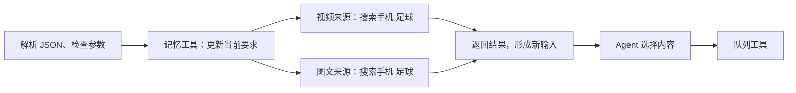

# 每一步：用户操作 → 输入 → JSON → 工具 → 内容

> 历史材料：保留当时内容，不作为现行方案。当前以 [研究主方案](../../../01-研究主方案.md) 和 [输入输出与数据流](../../../02-输入输出与数据流.md) 为准。

**同一个用户，从随便刷到找到手机拍足球的方法。** 例子使用可读内容名称，不要求记编号。全部数据由作者编写；工具实际运行在本地固定内容环境，未调用真实模型或网络。

下面的输入摘出本轮关键变化，模型同时收到此前记录、当前记忆及内容环境。输出片段使用实际字段和值。每一步未删减的请求、完整 JSON 输出及回执在 [episode.json](../../example/episode.json)，[逐步 JSON 展开](../../example/all-step-json.md)用于逐项核对。

## 1. 新用户进入，先随便刷

用户打开页面，没有发言、画像或历史。给 Agent 的关键输入：

```json
{"dialogue":[],"behavior_events":[{"type":"session_start","payload":{"history_available":false}}],"user_state":{"version":0,"records":[]},"environment":{"candidate_pool":[]}}
```

来源目录同时声明：图文来源支持热榜/搜索，视频来源支持搜索。

| Agent 输出 | 解析后调用 | 实际返回 |
|---|---|---|
| acquire：图文来源、hot、limit=3 | 图文来源的热榜工具 | 《手机摄影：先观察光线》《十分钟做一份早餐》《周末读一本短篇小说》 |
| 返回结果后的第二次输出：recommend，以上述顺序 append | 队列工具 | 三张内容排入待看队列 |

第一个获取动作的真实 arguments：

```json
{"source_ids":["图文来源"],"mode":"hot","query":null,"target_id":null,"content_types":["article"],"constraint_refs":[],"limit":3}
```

网页再记录实际可见：摄影和早餐看见了，阅读内容尚未看见。

## 2. 用户阅读并收藏，没有说话

用户打开摄影文章，前台阅读 22 秒，点击收藏。新增到输入：

```json
[
  {"type":"open","item_id":"手机摄影：先观察光线","payload":{}},
  {"type":"dwell","item_id":"手机摄影：先观察光线","payload":{"duration_ms":22000,"surface":"detail","foreground":true}},
  {"type":"save","item_id":"手机摄影：先观察光线","payload":{"value":true}}
]
```

| Agent 输出 | 工具怎样执行 | 后续结果 |
|---|---|---|
| update_state：写入“本次打开并收藏手机摄影内容”，scope=session、basis=observed | 记忆工具，版本 0→1 | 保存本次经历 |
| acquire：query="手机 摄影"，图文来源、limit=6，依赖上个更新 | 更新成功后调用搜索 | 得到构图、基础设置、跟拍步骤、检查单、器材参考 |
| 搜索返回后的 recommend | 队列工具重排待看内容 | 推荐构图练习和器材参考；此时还没有“不买器材”的要求 |

这一步没有用户指令。Agent 仍根据实际行为决定获取和推荐。

## 3. 用户提出需求，两路获取并行

原话：**“周末想用手机拍孩子踢球，不买器材，先给我短教程。”**

输入中加入这句话，同时提供当前记忆和已有候选：

```json
{
  "dialogue":[{"role":"user","text":"周末想用手机拍孩子踢球，不买器材，先给我短教程。"}],
  "user_state":{"version":1,"records":[{"kind":"episode","value":"本次打开并收藏手机摄影内容","scope":"session"}]},
  "environment":{"candidate_pool":[{"id":"手机拍足球：基础设置"},{"id":"手机跟拍足球：四个动作"},{"id":"手机拍运动：开拍检查单"},{"id":"运动摄影镜头怎么选"}]}
}
```

**Agent 输出三个动作。** 先由 update_state 写入当前拍摄任务、“不买器材”的 hard/avoid 要求、“短教程”的 soft/prefer 偏好，版本 1→2。它输出的另外两条搜索动作原文为：

```json
[
  {
    "action_id":"搜索手机足球视频",
    "kind":"acquire",
    "arguments":{"source_ids":["视频来源"],"mode":"search","query":"手机 足球","target_id":null,"content_types":["video"],"constraint_refs":["本任务不买器材","本任务偏好短教程"],"limit":2},
    "evidence_refs":["用户提出手机拍足球的需求"],
    "depends_on":["更新手机足球拍摄需求"]
  },
  {
    "action_id":"同时搜索手机足球图文",
    "kind":"acquire",
    "arguments":{"source_ids":["图文来源"],"mode":"search","query":"手机 足球","target_id":null,"content_types":["article"],"constraint_refs":["本任务不买器材","本任务偏好短教程"],"limit":6},
    "evidence_refs":["用户提出手机拍足球的需求"],
    "depends_on":["更新手机足球拍摄需求"]
  }
]
```

解析器将 kind=acquire 映射到固定来源工具，把 arguments 传进去。两个搜索都等同一次更新完成，彼此没有依赖：



[执行代码](../../example/replay.py)通过 asyncio.gather 同时调用两路来源，已检查峰值并发数为 2。实际来源查询与返回分别保存。

两路结果回给 Agent 后，它输出 recommend，arguments 为：

```json
{"ordered_item_ids":["手机拍足球：一分钟基础演示","手机拍足球：两分钟跟拍演示"],"delivery":"replace_pending"}
```

队列工具按内容记录生成卡片。网页显示第一条；用户播放 15 秒，写入实际播放片段。图文候选仍保留。

## 4. 用户改变要求，更新之后重排

原话：**“基础设置我会了，只看图文，给我跟拍的具体步骤。”**

本轮关键输入：

```json
{
  "dialogue":[{"role":"user","text":"基础设置我会了，只看图文，给我跟拍的具体步骤。","target_refs":["手机拍足球：一分钟基础演示","手机足球拍摄任务"]}],
  "behavior_events":[{"type":"play","item_id":"手机拍足球：一分钟基础演示","payload":{"duration_ms":15000}}],
  "user_state":{"version":2}
}
```

完整任务、以前的要求及图文候选仍在实际输入中。Agent 先输出 update_state，写入基础设置已会、当前任务只看 article、偏好具体步骤，版本 2→3。随后这个动作依赖更新成功：

```json
{
  "action_id":"推荐跟拍图文步骤",
  "kind":"recommend",
  "arguments":{"ordered_item_ids":["手机跟拍足球：四个动作","手机拍运动：开拍检查单"],"delivery":"replace_pending"},
  "evidence_refs":["用户要求只看图文步骤","搜索手机摄影图文"],
  "depends_on":["更新只看图文的要求"]
}
```

解析后调用队列工具，替换还没展示的视频。内容已经取得，这次不用再搜。用户实际看见两篇图文、阅读并收藏；这些事件进入下一次输入。

## 5. 用户说够了，结束当前任务

原话：**“这两条够了，我去试试。”** Agent 同时读到两篇图文的实际阅读与收藏。

| 输出 | 对应工具效果 |
|---|---|
| update_state：将“手机足球拍摄任务”的 status 设为 completed | 记录这次找教程结束 |
| idle：mode=end_task、task_id=手机足球拍摄任务；依赖上个更新 | 停止本任务继续补充 |
| respond：text="好，先到这里。" | 对话工具发出回复；与状态更新无依赖，可同组执行 |

实际退出由网页另记 session_end。找信息结束与实际拍摄是否成功分别保存。

## 6. 同一个例子怎样评

取第 4 步原话后的**同一份原始经历**，让不同系统各交下一条，再匿名展示《手机跟拍足球：四个动作》《手机拍运动：开拍检查单》《手机拍足球：基础设置》。

用户选此刻最想看的，可以并列或都不想看。[选择题样例](../../example/next-item-choice.json)保存截止点、系统到内容的对应、随机位置和答案。该题与上面的单系统连续轨迹分别记录，答案不回灌给全部系统冒充各自的实际反馈。

主指标、连续续用选择和 NDCG 计算见[怎样评好坏](../../references/evaluation-details.md)。全部更新动作原文、输入与回执见[完整记录](../../example/episode.json)。
